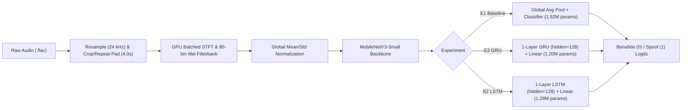
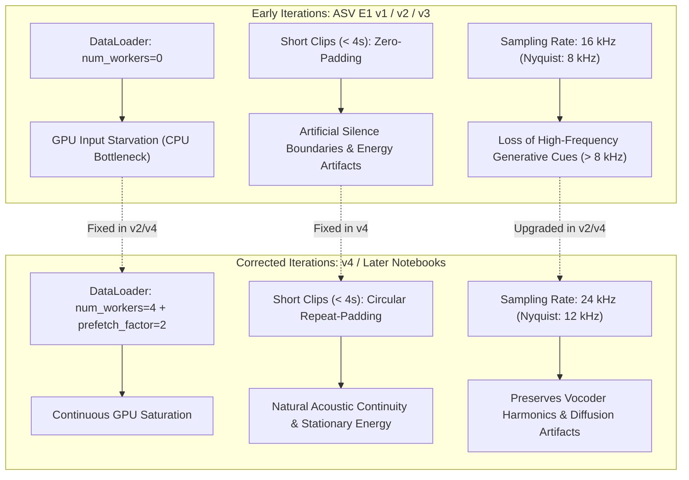

# Audio Deepfake Classification: Lightweight CNN & Hybrid Temporal Architectures

A deep learning research framework for lightweight, robust detection of synthetic audio across speech and non-speech acoustic domains. This repository benchmarks efficient convolutional backbones ([MobileNetV3-Small](https://arxiv.org/abs/1905.02244)) and hybrid spatial-temporal architectures (CNN + GRU / LSTM) on two major benchmarks: **ASVspoof 2019 Logical Access (LA)** and **AT-ADD Track 2**.

---

## Table of Contents
- [Project Overview](#project-overview)
- [Dataset Characteristics & Experimental Design](#dataset-characteristics--experimental-design)
  - [ASVspoof 2019 Logical Access (LA)](#1-asvspoof-2019-logical-access-la)
  - [AT-ADD Track 2 (Multi-Domain Audio)](#2-at-add-track-2-multi-domain-audio)
  - [Summary Comparison](#dataset-comparison-matrix)
- [Model Architectures](#model-architectures)
  - [E1: Lightweight CNN Baseline](#e1-mobilenetv3-small-baseline)
  - [E2: Hybrid Spatial-Temporal Models (CNN + GRU / LSTM)](#e2-hybrid-mobilenetv3-small--grulstm)
- [Pipeline Evolution, Gotchas & Iterative Fixes](#pipeline-evolution-gotchas--iterative-fixes)
  - [1. Resolving Input Pipeline Starvation](#1-resolving-input-pipeline-starvation)
  - [2. Transition from Zero-Padding to Repeat-Padding](#2-transition-from-zero-padding-to-repeat-padding)
  - [3. Sampling Frequency Upgrade (16 kHz to 24 kHz)](#3-sampling-frequency-upgrade-16-khz-to-24-khz)
  - [4. Generator-Disjoint Validation Partitioning (Issue 34 Fix)](#4-generator-disjoint-validation-partitioning-issue-34-fix)
  - [5. Multi-Seed Statistical Protocol & Convergence Budget (Issue 35 Fix)](#5-multi-seed-statistical-protocol--convergence-budget-reviewer-issue-35-fix)
- [Empirical Results & Key Findings](#empirical-results--key-findings)
  - [ASVspoof 2019 LA Evaluation](#asvspoof-2019-la-eval-results)
  - [AT-ADD Track 2 Evaluation](#at-add-track-2-eval-results)
  - [Domain-Specific Breakdown on AT-ADD (E1 v4)](#domain-specific-breakdown-on-at-add-e1-v4)
- [Repository Structure](#repository-structure)

---

## Project Overview

With the rapid progression of generative speech synthesis (TTS) and neural voice conversion (VC) systems, detecting synthesized and manipulated audio is essential for authentication, security, and forensics. However, real-world deployment faces two key challenges:
1. **Model Efficiency:** Practical edge and mobile applications require small parameter footprints and low inference latency.
2. **Domain Generalization:** While traditional anti-spoofing focuses strictly on speech, deepfake audio increasingly spans singing voice conversion, synthetic music, and environmental sound synthesis.

This repository systematically evaluates lightweight detection pipelines:
- **E1 Baseline:** A pure lightweight 2D CNN based on [MobileNetV3-Small](https://arxiv.org/abs/1905.02244) (~1.52M parameters).
- **E2 Hybrid Models:** MobileNetV3-Small combined with a single-layer recurrent temporal pooling head (**GRU** or **LSTM**, ~1.20M–1.29M parameters).
- **Audio Preprocessing Upgrades:** An evolving frontend addressing input starvation, short-clip boundary artifacts (zero-padding vs. repeat-padding), and high-frequency generative artifact retention (16 kHz vs. 24 kHz).

---

## Dataset Characteristics & Experimental Design

The repository uses two complementary benchmarks to assess model discrimination under disjoint conditions.

### 1. ASVspoof 2019 Logical Access (LA)
- **Primary Domain:** Speech only (clean telephonic and studio voice recordings).
- **Disjoint Partitioning:**
  - **Speaker-Disjoint:** Evaluation set speakers are completely disjoint from the training and development sets.
  - **Generator-Disjoint:** Training and development sets contain spoofed audio generated by 6 algorithms (A01–A06), whereas the evaluation set tests robustness against 13 unseen spoofing systems (A07–A19), spanning acoustic model TTS, waveform concatenation, neural vocoding, and voice conversion.
- **Dataset Limitation:** Lacks non-speech audio entirely. Models trained solely on ASVspoof cannot generalize to synthetic music, singing, or environmental sounds.

### 2. AT-ADD Track 2 (Multi-Domain Audio)
To investigate synthetic audio detection beyond isolated speech, the research migrated to the **AT-ADD Track 2** dataset.
- **Acoustic Domains:** Spans 4 distinct audio classes:
  - `speech` (conventional speech synthesis and voice conversion)
  - `singing` (singing voice conversion and neural vocoding)
  - `music` (AI-generated music tracks and accompaniment)
  - `sound` (environmental audio effects and general non-speech sounds)
- **Generator-Disjoint Status (Reviewer Issue 34 Resolution):**
  - **Legacy Benchmark Limitation:** In the official raw dataset and legacy manifests (`data/manifests/train_manifest.csv` and `dev_manifest.csv`), the development set shared **100% of its generative architectures (29/29)** with training ($G_{\text{Train}} \cap G_{\text{Dev}} = 29$), causing baseline detectors to overfit to seen generator artifacts (~0.93 Dev Macro-F1 vs. ~0.67 Eval Macro-F1).
  - **New Generator-Disjoint Manifests:** Resolved via [`src/datasets/create_atadd_disjoint_manifests.py`](file:///home/abhijithjayan23bcs109/Audio_DeepFake_Classification/src/datasets/create_atadd_disjoint_manifests.py). The new manifests in [`data/manifests/AT_ADD/`](file:///home/abhijithjayan23bcs109/Audio_DeepFake_Classification/data/manifests/AT_ADD) hold out 8 distinct generators exclusively for validation ($16{,}000$ fake + $6{,}536$ real = $22{,}536$ clips), assign 21 generators to training ($44{,}000$ fake + $16{,}000$ real = $60{,}000$ clips), and test on 38 unseen generators in evaluation ($37{,}753$ fake + $6{,}536$ real = $44{,}289$ clips), achieving **$100\%$ pairwise generator disjointness** across all splits.
  - **Frozen Split Status:** The disjoint split in `data/manifests/AT_ADD/` is cryptographically frozen and read-only (`chmod 444`). Full audit details, counts, domain distributions, duration distributions, and SHA-256 digests are formally recorded in [`docs/rerun/MANIFEST_FREEZE_AUDIT.md`](file:///home/abhijithjayan23bcs109/Audio_DeepFake_Classification/docs/rerun/MANIFEST_FREEZE_AUDIT.md).
- **Speaker-Disjoint Status (Limitation):**
  - While generator disjointness is formally verified, **speaker-disjointness cannot be proven** for AT-ADD Track 2. Source-level metadata (`speaker_id`) is incomplete or unannotated across many internet sources and non-speech categories, making strict speaker separation unverifiable.

### Dataset Comparison Matrix

| Property | ASVspoof 2019 LA | AT-ADD Track 2 (Disjoint Benchmark) | AT-ADD Track 2 (Legacy Manifests) |
| :--- | :--- | :--- | :--- |
| **Audio Content** | Speech only | Speech, Singing, Music, Environmental Sound | Speech, Singing, Music, Environmental Sound |
| **Speaker-Disjoint** | **Yes** (Strictly verified) | **Cannot be proven** (Incomplete speaker metadata) | **Cannot be proven** (Incomplete speaker metadata) |
| **Generator-Disjoint** | **Yes** (Train: A01–A06 vs. Eval: A07–A19) | **Yes** (Train: 21, Dev: 8, Eval: 38 - $0\%$ overlap) | **Partial** (Train $\cap$ Dev = 29 shared; Train $\cap$ Eval = 0) |
| **Training Partition** | 25,380 samples | **60,000 samples** (`data/manifests/AT_ADD/train_manifest.csv`) | 46,000 samples (`data/manifests/train_manifest.csv`) |
| **Development Partition** | 24,844 samples | **22,536 samples** (`data/manifests/AT_ADD/dev_manifest.csv`) | 36,536 samples (`data/manifests/dev_manifest.csv`) |
| **Evaluation Partition** | 71,237 samples | **44,289 samples** (`data/manifests/AT_ADD/eval_manifest.csv`) | 44,289 samples (`data/manifests/eval_manifest.csv`) |
| **Evaluation Challenge** | Unseen voice conversion & TTS algorithms | Cross-domain acoustic shifts & 38 unseen generative architectures | Cross-domain acoustic shifts & 38 unseen generative architectures |

---

## Model Architectures



### E1: MobileNetV3-Small Baseline
- **Backbone:** Modified [MobileNetV3-Small](https://arxiv.org/abs/1905.02244) adapted for single-channel 2D time-frequency inputs (80-bin log-Mel spectrograms).
- **Design Philosophy:** Uses depthwise separable convolutions, squeeze-and-excitation (SE) modules, and hard-swish non-linearities for high computational efficiency.
- **Parameters:** ~1,519,618 trainable parameters.
- **Pooling & Head:** Spatial global average pooling collapsing time and frequency dimensions, followed by a linear classification layer with dropout (0.2).

### E2: Hybrid MobileNetV3-Small + GRU/LSTM
- **Motivation:** Audio deepfakes often introduce local spectral artifacts (detected well by CNNs) as well as long-term temporal incoherence or boundary irregularities (better captured sequentially).
- **Temporal Modeling Head:** Instead of collapsing the temporal dimension with global pooling, feature maps from the CNN spatial backbone preserve frame sequences and feed into a recurrent sequence layer:
  - **E2 GRU:** Single-layer Gated Recurrent Unit (`hidden_size=128`, bidirectional=False, ~1.198M parameters).
  - **E2 LSTM:** Single-layer Long Short-Term Memory (`hidden_size=128`, bidirectional=False, ~1.288M parameters).
- **Classifier:** The final hidden state of the recurrent layer is passed through dropout (0.2) to the binary classification projection.

---

## Pipeline Evolution, Gotchas & Iterative Fixes

Throughout development, several subtle data pipeline and acoustic preprocessing bottlenecks were identified and resolved across iterations:



### 1. Resolving Input Pipeline Starvation
- **The Issue (ASV E1 v1):**
  In [`notebooks/ASV_E1_MobileNetV3Small_Baseline_v1.ipynb`](file:///home/abhijithjayan23bcs109/Audio_DeepFake_Classification/notebooks/ASV_E1_MobileNetV3Small_Baseline_v1.ipynb), PyTorch's `DataLoader` was configured with `NUM_WORKERS=0`. Audio decoding (librosa/soundfile) and waveform cropping occurred synchronously on the main thread, causing severe GPU starvation while waiting for data.
- **The Fix:**
  In subsequent versions (`ASV_E1_v2` and all `v4` notebooks), the pipeline was refactored with asynchronous multi-process loading:
  ```python
  NUM_WORKERS = 4
  PREFETCH_FACTOR = 2
  dataloader = DataLoader(
      dataset,
      batch_size=32,
      shuffle=True,
      num_workers=NUM_WORKERS,
      pin_memory=True,
      persistent_workers=True,
      prefetch_factor=PREFETCH_FACTOR
  )
  ```
  Waveform loading and resampling run across worker CPU processes, while batched STFT, Mel extraction, and normalization execute on the GPU via [`GPULogMel`](file:///home/abhijithjayan23bcs109/Audio_DeepFake_Classification/src/preprocessing/preprocess_atadd_v4.py#L80-L100).

### 2. Transition from Zero-Padding to Repeat-Padding
- **The Issue (< 4s Clips):**
  Early notebooks padded audio shorter than 4 seconds with zeros (silence). In deepfake detection:
  - Zero-padding introduces sharp artificial step boundaries in the time-frequency domain.
  - Spectral normalization (zero-mean, unit-variance) is skewed by large blocks of synthetic zeros.
  - More critically, if real and fake recordings possess different duration distributions, a CNN can latch onto the *silence ratio* as a shortcut rather than learning genuine generative synthesis artifacts.
- **Diagnostic Tool:**
  [`check_padding_diagnostics.py`](file:///home/abhijithjayan23bcs109/Audio_DeepFake_Classification/check_padding_diagnostics.py) was built to measure clip durations and padding frequency across every split, audio type, and label.
- **The Fix:**
  Transitioned to circular **repeat-padding** in [`src/preprocessing/preprocess_atadd_v4.py`](file:///home/abhijithjayan23bcs109/Audio_DeepFake_Classification/src/preprocessing/preprocess_atadd_v4.py#L40-L52):
  ```python
  def repeat_pad_audio(waveform, num_samples):
      if len(waveform) >= num_samples:
          return waveform[:num_samples]
      repeats = int(np.ceil(num_samples / len(waveform)))
      padded = np.tile(waveform, repeats)
      return padded[:num_samples]
  ```
  Repeating short waveforms preserves continuous acoustic texture, maintains stationary energy levels, and removes silence-boundary artifacts.

### 3. Sampling Frequency Upgrade (16 kHz to 24 kHz)
- **The Issue (16 kHz Downsampling):**
  Earlier iterations downsampled all audio to 16 kHz ($F_s/2 = 8\text{ kHz}$). Modern high-fidelity neural vocoders (e.g., HiFi-GAN, BigVGAN, DiffGANTTS) and music generation models synthesize at 24 kHz, 44.1 kHz, or 48 kHz. Downsampling to 16 kHz completely discards spectral cues, phase inconsistencies, and harmonic roll-offs above 8 kHz.
- **The Fix:**
  Upgraded the entire audio frontend across both ASV and AT-ADD baseline pipelines to **24 kHz**:
  - Sample rate: $24{,}000\text{ Hz}$ ($N_{\text{samples}} = 96{,}000$ for 4.0 seconds)
  - STFT parameters: $N_{\text{FFT}} = 1024$, $\text{Window Length} = 600$ (25 ms), $\text{Hop Length} = 240$ (10 ms), Mel bins = 80
  - Captures acoustic artifacts up to 12 kHz, improving AT-ADD E1 evaluation EER from 21.54% down to 19.92%.

### 4. Generator-Disjoint Validation Partitioning (Reviewer Issue 34 Fix)
- **The Issue (In-Distribution Validation vs. Zero-Shot Evaluation):**  
  In Phase-I review, Reviewer Issue 34 observed a severe generalization gap on AT-ADD baselines: Dev Macro-F1 was $\approx 0.93$ (EER $\approx 3.5\%$) while Eval Macro-F1 dropped to $\approx 0.67$ (EER $\approx 19.9\%$). Investigation revealed that the official AT-ADD Track 2 development partition shared **100% of its generative architectures (29 out of 29)** with the training partition ($G_{\text{Train}} \cap G_{\text{Dev}} = 29$). Consequently, checkpoint selection optimized for memorizing training generator artifacts rather than true out-of-distribution generalization.
- **The Fix (Strictly Disjoint Manifest Generation):**  
  Built a new generator-disjoint manifest creator in [`src/datasets/create_atadd_disjoint_manifests.py`](file:///home/abhijithjayan23bcs109/Audio_DeepFake_Classification/src/datasets/create_atadd_disjoint_manifests.py):
  - **Holdout Validation (8 systems):** Holds out 8 distinct generators exclusively for dev (`CosyVoice`, `Llasa1B`, `MeloTTS`, `Tortoise-TTS`, `WaveNet`, `Audiogen`, `SeedVC`, `MusicGen`), totaling **$22{,}536$ clips** ($16{,}000$ fake + $6{,}536$ real).
  - **Training (21 systems):** Assigns the remaining 21 generators to training, totaling **$60{,}000$ clips** ($44{,}000$ fake + $16{,}000$ real).
  - **Evaluation (38 unseen systems):** Preserves the full stratified benchmark of **$44{,}289$ clips** ($37{,}753$ fake + $6{,}536$ real), avoiding the computational bottleneck of the raw 229k uncurated pool while retaining 100% of the 38 zero-shot evaluation architectures.
  - **Disjointness Guarantees:** Formally asserts $\text{Train} \cap \text{Dev} = \emptyset$, $\text{Train} \cap \text{Eval} = \emptyset$, and $\text{Dev} \cap \text{Eval} = \emptyset$.
  - **Execution:**
    ```bash
    python src/datasets/create_atadd_disjoint_manifests.py
    ```
    Outputs manifests and SHA-256 checksums to [`data/manifests/AT_ADD/`](file:///home/abhijithjayan23bcs109/Audio_DeepFake_Classification/data/manifests/AT_ADD).
- **Dataloader Support:**  
  Updated [`src/datasets/atadd_manifest_dataset.py`](file:///home/abhijithjayan23bcs109/Audio_DeepFake_Classification/src/datasets/atadd_manifest_dataset.py#L72-L76) to read the `folder` column (`train`, `dev`, or `eval`), loading pooled audio across physical directories with zero I/O latency penalty on local NVMe storage.

### 5. Multi-Seed Statistical Protocol & Convergence Budget (Reviewer Issue 35 Fix)
- **The Issue (Single-Seed & Premature Training Termination):**  
  In Phase-I review, Reviewer Issue 35 highlighted two critical methodological shortcomings:
  1. Both baseline and hybrid models were trained for at most 20 epochs from scratch; training metrics showed the models were still improving at epoch 20 (peaked at the final epoch), indicating incomplete convergence.
  2. All experiments were conducted using only a single random seed (`42`), omitting error margins and statistical significance analysis across random weight initializations and batch orderings.
- **The Fix (Extended Budget to Full Convergence):**  
  - Increased the training budget from 20 to **35 epochs** (`EPOCHS = 35`).
  - Implemented early stopping with an extended patience of **10 epochs** (`PATIENCE = 10`), monitored on Development Macro-F1.
  - Coupled with dynamic learning rate scheduling via `torch.optim.lr_scheduler.ReduceLROnPlateau(mode='max', factor=0.5, patience=3, min_lr=1e-6)`.
- **The Fix (3 Fixed Benchmark Random Seeds):**  
  To provide statistically rigorous evaluation and enable reporting of **Mean ± Standard Deviation**, three fixed random seeds are established across all rerun experimental phases:
  - **Seed 1:** `42` (`seed1`) — Primary reproducibility anchor
  - **Seed 2:** `1337` (`seed2`) — Verification seed
  - **Seed 3:** `2024` (`seed3`) — Triangulation seed
- **Rerun Directory Structure & File Naming Conventions:**  
  To ensure clean segregation between legacy single-seed runs and the new multi-seed rerun protocol, all outputs are systematically organized inside dedicated `rerun/` subdirectories with explicit seed tagging (`seed1`, `seed2`, `seed3`) embedded in all generated artifact filenames:
  - **Checkpoints:** `checkpoints/rerun/E1/E1_MobileNetV3Small_ATADD_best_seed{1,2,3}.pt`
  - **Experiment Records:** `experiments/baselines/rerun/E1/`
    - Metrics: `E1_ATADD_eval_metrics_seed{1,2,3}.json`
    - History: `E1_ATADD_training_history_seed{1,2,3}.csv`
    - Predictions: `E1_ATADD_eval_predictions_seed{1,2,3}.csv` & `E1_ATADD_val_predictions_seed{1,2,3}.csv`
    - Domain Breakdown: `E1_ATADD_eval_type_results_seed{1,2,3}.csv`
    - Generator Breakdown: `E1_ATADD_eval_generator_results_seed{1,2,3}.csv`
    - Failure Cases: `E1_ATADD_eval_failure_cases_seed{1,2,3}.csv`
    - Feature Norms: `E1_ATADD_logmel_stats_seed{1,2,3}.json`
    - Run Configurations: `E1_ATADD_config_seed{1,2,3}.json`
  - **Result Tables:** `results/tables/rerun/E1/eval_domain_summary_seed{1,2,3}.csv`
  - **Result Figures:** `results/figures/rerun/E1/`
    - Training curves: `E1_ATADD_training_curves_seed{1,2,3}.png`
    - Eval Confusion Matrices: `E1_ATADD_eval_confusion_matrix_seed{1,2,3}.png`
    - Validation Matrices: `E1_ATADD_validation_confusion_matrix_seed{1,2,3}.png`
  - **Execution Logs:** `results/logs/rerun/E1/`

---

## Empirical Results & Key Findings

### ASVspoof 2019 LA Eval Results
Evaluated on 71,237 utterances against unseen spoofing systems (A07–A19):

| Model | Architecture | Frontend | Accuracy (%) | Macro F1 | AUROC | EER (%) |
| :--- | :--- | :--- | :---: | :---: | :---: | :---: |
| **E1 v2** | MobileNetV3-Small | 24 kHz | 75.32% | 0.6478 | 0.9324 | 12.49% |
| **E2 GRU v1** | MobileNetV3-Small + GRU | 16 kHz | 86.67% | 0.7633 | 0.9599 | **7.55%** |
| **E2 LSTM v1**| MobileNetV3-Small + LSTM | 16 kHz | 86.48% | 0.7609 | 0.9666 | **6.82%** |

> **Insight:** Adding sequential temporal modeling (GRU / LSTM) to the MobileNetV3 backbone cut the Equal Error Rate (EER) nearly in half on ASVspoof 2019 LA (from 12.49% to 6.82%), demonstrating the importance of tracking temporal coherence across speech frames.

---

### AT-ADD Track 2 Eval Results
Evaluated on 44,289 multi-domain audio clips against completely unseen generators:

| Experiment | Model Backbone | Audio Frontend | Accuracy (%) | Macro F1 | AUROC | EER (%) |
| :--- | :--- | :--- | :---: | :---: | :---: | :---: |
| **E1 v3** | MobileNetV3-Small | 16 kHz + Zero-Pad | 71.34% | 0.6409 | 0.8644 | 21.54% |
| **E1 v4** | MobileNetV3-Small | 24 kHz + Repeat-Pad | **75.70%** | **0.6776** | **0.8750** | **19.92%** |
| **E2 GRU v4** | MobileNetV3-Small + GRU | 24 kHz + Repeat-Pad | 69.89% | 0.6296 | 0.8425 | 22.43% |
| **E2 LSTM v4**| MobileNetV3-Small + LSTM | 24 kHz + Repeat-Pad | 69.60% | 0.6258 | 0.8622 | 22.15% |

---

### Domain-Specific Breakdown on AT-ADD (E1 v4)
Evaluation performance across individual audio categories reveals significant domain disparity:

| Audio Domain | Total Samples | Real | Fake | Macro F1 | AUROC | EER (%) | Primary Failure Mode |
| :--- | :---: | :---: | :---: | :---: | :---: | :---: | :--- |
| **Singing** | 6,753 | 2,000 | 4,753 | **0.8240** | **0.9447** | **12.50%** | High discrimination across SVC systems |
| **Speech** | 27,000 | 2,000 | 25,000 | **0.6814** | **0.9289** | **14.20%** | Strong general detection; challenges on BigVGAN |
| **Sound (Env)** | 6,000 | 2,000 | 4,000 | 0.5365 | 0.7435 | 34.36% | High variance in acoustic backgrounds |
| **Music** | 4,536 | 536 | 4,000 | **0.3907** | **0.5593** | **46.09%** | Severe false negatives on *SSM-TTM* & *ACE-Step* |

> **Key Takeaway:** Multi-domain audio deepfake detection is substantially harder than speech-only detection. Models perform reliably on speech and singing (EER ~12–14%), but encounter severe blind spots on environmental sounds and music (EER ~34–46%), where state-of-the-art music generators easily bypass lightweight detectors.

---

## Directory Structure

```
Audio_DeepFake_Classification/
├── check_padding_diagnostics.py     # Standalone padding & duration distribution auditor
├── checkpoints/                     # Model weights & training checkpoints
│   ├── rerun/                       # Generator-disjoint convergence reruns (35 epochs, 3 seeds)
│   │   └── E1/                      # E1 baseline checkpoints (best_seed1.pt, best_seed2.pt, best_seed3.pt)
│   ├── ASV_E1_v2/
│   └── ...
├── configs/                         # Experiment JSON configuration templates
├── data/
│   ├── manifests/
│   │   ├── ASVSpoof/               # ASVspoof 2019 LA official manifests (train, dev, eval)
│   │   ├── AT_ADD/                 # Production generator-disjoint manifests (train: 60k, dev: 22.5k, eval: 44.3k)
│   │   │   ├── train_manifest.csv  # 21 training generators + 16k balanced real
│   │   │   ├── dev_manifest.csv    # 8 holdout validation generators + 6.5k real
│   │   │   ├── eval_manifest.csv   # 38 zero-shot unseen generators + 6.5k real
│   │   │   └── MANIFEST_SHA256.txt # Manifest SHA-256 verification hashes
│   │   ├── train_manifest.csv      # Legacy AT-ADD train manifest (coupled, 46k)
│   │   ├── dev_manifest.csv        # Legacy AT-ADD dev manifest (coupled, 36.5k)
│   │   └── eval_manifest.csv       # Stratified AT-ADD eval manifest (44.3k)
│   ├── metadata/                   # Source metadata, generator stats & protocol mappings
│   └── raw/                        # Raw audio storage (467,223 .flac files across train, dev, eval)
├── docs/                           # Dataset investigation reports & PDF logs
│   └── AT_ADDT2_rerun/             # Forensic dataset analysis & generator-disjoint design notebook
├── experiments/
│   └── baselines/
│       ├── rerun/                  # Multi-seed rerun artifacts (Issue 35)
│       │   └── E1/                 # E1 metrics, predictions, histories, and configs for seeds 1, 2, 3
│       ├── ASV_E1_v2/              # ASV E1 v2 metrics, predictions, configs
│       ├── ASV_E2_LSTM/            # ASV E2 LSTM metrics & comparative tables
│       ├── E1/                     # Legacy E1 experiment artifacts (v1 & v3)
│       ├── E1_v4/                  # AT-ADD E1 v4 (24 kHz, repeat-pad) artifacts
│       ├── E2_GRU/                 # Legacy E2 GRU artifacts
│       ├── E2_GRU_v4/              # AT-ADD E2 GRU v4 artifacts
│       ├── E2_LSTM/                # Legacy E2 LSTM artifacts
│       └── E2_LSTM_v4/             # AT-ADD E2 LSTM v4 artifacts
├── notebooks/
│   ├── AT_ADD/                     # Comprehensive generator-disjointness audit scripts & reports
│   │   └── Rerun/                  # Generator-disjoint retraining notebooks (35 epochs, 3 seeds)
│   │       ├── ATADD_E1_MobileNetV3Small_Disjoint_24kHz_RepeatPad.ipynb        # Master E1 rerun notebook
│   │       ├── ATADD_E1_MobileNetV3Small_Disjoint_24kHz_RepeatPad_seed1.ipynb  # Configured for Seed 1 (42)
│   │       ├── ATADD_E1_MobileNetV3Small_Disjoint_24kHz_RepeatPad_seed2.ipynb  # Configured for Seed 2 (1337)
│   │       └── ATADD_E1_MobileNetV3Small_Disjoint_24kHz_RepeatPad_seed3.ipynb  # Configured for Seed 3 (2024)
│   ├── ASV_E1_MobileNetV3Small_Baseline_v1.ipynb          # ASV E1 v1 (16 kHz, zero-pad, workers=0)
│   ├── ASV_E1_MobileNetV3Small_Baseline_v2_corrected.ipynb# ASV E1 v2 (24 kHz, optimized pipeline)
│   ├── ASV_E2_MobileNetV3Small_GRU_Baseline_v1.ipynb      # ASV E2 GRU v1
│   ├── ASV_E2_MobileNetV3Small_GRU_Baseline_v2.ipynb      # ASV E2 GRU v2
│   ├── ASV_E2_MobileNetV3Small_LSTM_Baseline_v1.ipynb     # ASV E2 LSTM v1
│   ├── ASV_E2_MobileNetV3Small_LSTM_Baseline_v2.ipynb     # ASV E2 LSTM v2
│   ├── ATADD_E1_MobileNetV3Small_Baseline_v3_fixed2.ipynb # AT-ADD E1 v3 (16 kHz, zero-pad)
│   ├── ATADD_E1_MobileNetV3Small_Baseline_v4_24kHz_RepeatPad.ipynb     # AT-ADD E1 v4 (24 kHz, repeat-pad)
│   ├── ATADD_E2_MobileNetV3Small_GRU_Baseline_v4_24kHz_RepeatPad.ipynb # AT-ADD E2 GRU v4
│   └── ATADD_E2_MobileNetV3Small_LSTM_Baseline_v4_24kHz_RepeatPad.ipynb# AT-ADD E2 LSTM v4
├── results/
│   ├── figures/                    # Training curves, confusion matrices, ROC curves
│   │   └── rerun/                  # Rerun figures with seed tags (curves, eval/val CMs)
│   ├── logs/                       # Epoch logs & execution outputs
│   │   └── rerun/                  # Rerun execution logs
│   └── tables/                     # Padding diagnostics & detailed evaluation tables
│       └── rerun/                  # Rerun domain summaries (eval_domain_summary_seed{1,2,3}.csv)
└── src/
    ├── datasets/
    │   ├── atadd_manifest_dataset.py       # PyTorch Dataset supporting multi-folder audio resolution
    │   ├── check_at_add_integrity.py       # Generator leakage & metadata audit script
    │   ├── create_atadd_disjoint_manifests.py # Production generator-disjoint manifest creator (Issue 34)
    │   ├── create_btp_dataset.py           # Outdated legacy manifest generator (deprecated)
    │   └── verify_at_add.py                # File existence validator against manifests
    └── preprocessing/
        ├── prepare_asvspoof_v1.py  # ASVspoof 2019 protocol parser & SHA256 hasher
        ├── preprocess_atadd.py     # Legacy 16 kHz audio frontend
        └── preprocess_atadd_v4.py  # Production 24 kHz + repeat-pad + GPU STFT module
```

---

