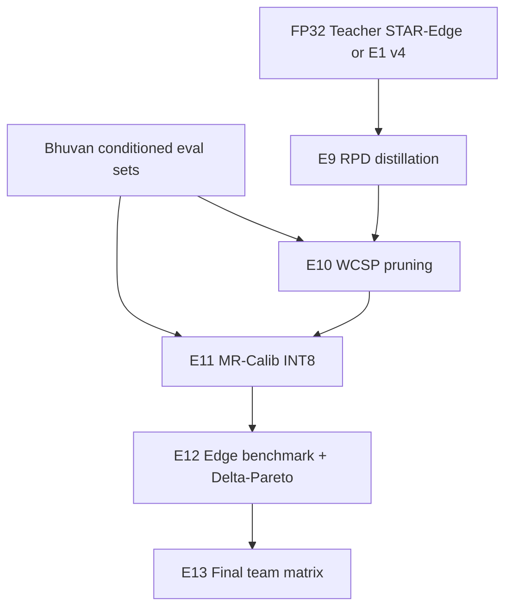

# Experiment Plan — E9 to E12 (Joshi)

**Method:** Δ-CEP (see `01_NOVEL_METHOD_DELTA-CEP_SPEC.md`)  
**Plan matrix IDs:** E9 distillation, E10 pruning, E11 INT8, E12 edge benchmark

---

## Dependency graph



---

## E9 — Knowledge distillation (robustness-preserving)

| Run | Teacher | Student | Loss |
|-----|---------|---------|------|
| E9-T0 | — | E1 v4 FP32 | — (baseline) |
| E9-T1 | E1 v4 | Same arch | Classic KD (clean only) — **generic baseline** |
| E9-T2 | STAR-Edge | Same arch | **RPD** (clean + degraded) |
| E9-T3 | STAR-Edge | 0.75× width | RPD |

**Outputs:** `experiments/edge/E9_*_metrics.json`, training curves, param count.

**Primary question:** Does RPD (E9-T2) beat E9-T1 on **macro-ΔM** at similar clean F1?

---

## E10 — Structured pruning

| Run | Method | Prune % |
|-----|--------|---------|
| E10-P0 | None | 0 |
| E10-P1 | L1 magnitude | 10, 20, 30 |
| E10-P2 | **WCSP** | 10, 20, 30 |

Fine-tune after each with **RPD** (3 epochs minimum).

**Outputs:** Params, FLOPs (torchprofile or fvcore), clean + conditioned metrics.

**Figure:** Params vs macro-ΔF1 (plan §11.2 trade-off plot).

---

## E11 — INT8 quantization

| Run | Calibration data | Model input |
|-----|------------------|-------------|
| E11-Q0 | FP32 student (no quant) | — |
| E11-Q1 | **Clean mel only** | PTQ |
| E11-Q2 | **MR-Calib 50/50** | PTQ |
| E11-Q3 | MR-Calib | QAT (if Q2 fails ΔM gate) |
| E11-Q4 | MR-Calib + **SAPD** split precision | PTQ trunk only |

**ΔM regression gate:** If macro-ΔF1 worsens >15% vs FP32 student, trigger Q11-Q3.

**Outputs:** Model size on disk (.onnx / .tflite), bit-width report.

---

## E12 — Edge benchmark

**Document everything in `03_EDGE_BENCHMARK_PROTOCOL.md`.**

| Variant | Measure |
|---------|---------|
| FP32 E1 v4 | Latency p50/p95, peak RAM, size |
| FP32 STAR-Edge | Same |
| Δ-CEP final INT8 | Same |
| Optional: Raspberry Pi 4 / Jetson Nano / laptop CPU-only | Same protocol |

**Detection quality on device:** Must match server ORT within ε (e.g. 1e-4 logit) — sanity check.

**Table (plan Section 8.4):**

| Variant | Quality (F1 / ΔM) | Size | Params | Memory | Latency |
|---------|-------------------|------|--------|--------|---------|
| Teacher FP32 | TBD | TBD | TBD | TBD | TBD |
| Student distilled | TBD | … | | | |
| Pruned | TBD | … | | | |
| INT8 Δ-CEP | TBD | … | | | |
| **Final edge** | TBD | … | | | |

---

## Δ-CEP ablation bundle (Joshi “E8 equivalent”)

| ID | Remove | Hypothesis |
|----|--------|------------|
| D1 | Degraded KL in RPD | ΔM worsens |
| D2 | WCSP → magnitude prune | ΔM worsens at same sparsity |
| D3 | MR-Calib → clean only | INT8 ΔM worsens |
| D4 | Δ-Pareto → clean-F1 only pick | Wrong operating point for deployment story |

---

## Naming convention

```text
{student}_{stage}_{condition_policy}_atadd_s{seed}
```

Examples:

- `mobilenetv3_rpd_star_edge_s42`  
- `mobilenetv3_wcsp30_mrcalib_int8_s42`  
- `mobilenetv3_delta_cep_final_s42`

---

## Timeline (suggested)

| Week | Task |
|------|------|
| W1 | J1 export + E9-T1/T2 smoke tests |
| W2 | E10 ladder + E11-Q1 vs Q2 |
| W3 | E12 protocol on 2 devices + Pareto figure |
| W4 | E13 row + individual analysis doc |

---

## Link to final evaluation (E13)

Joshi supplies **one** `delta_cep_final` row:

- Clean + top-3 worst conditions from E5  
- Same utterances as Nikkath E13  
- Efficiency columns filled from E12
