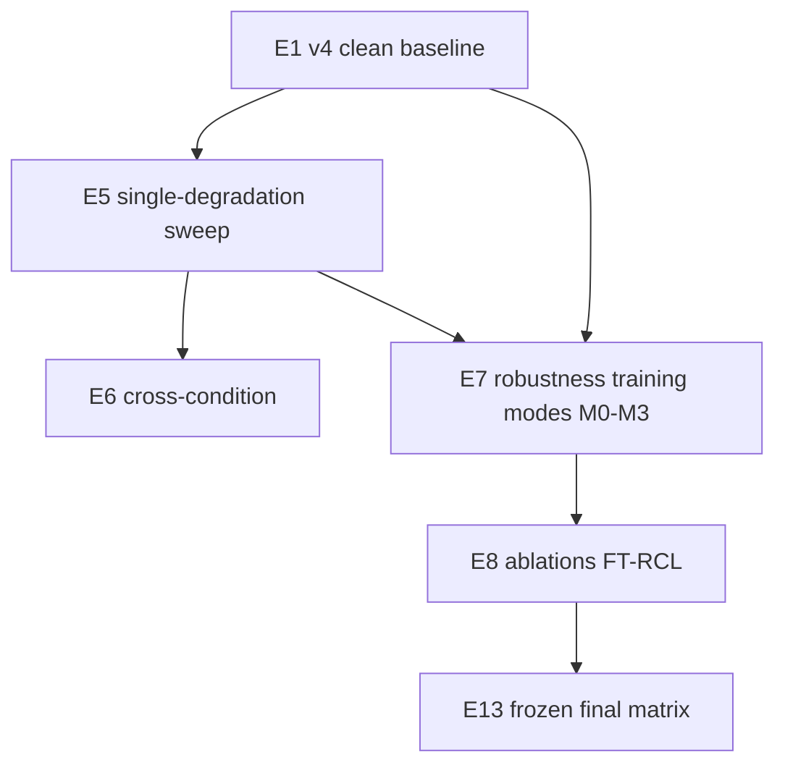

# Experiment Matrix: Robustness Pipeline (E5–E8, E13)

**Links:** Prerequisites `00_PIPELINE_PREREQUISITES.md` · Method `01_NOVEL_METHOD_FT-RCL_SPEC.md`

---

## 1. Experiment dependency graph



---

## 2. E5 — Single-degradation sweep (Bhuvan lead, Nikkath evaluates)

**Question:** Which conditions cause the largest **ΔM** on frozen E1 v4?

| Setting | Value |
|---------|--------|
| Model | E1 v4 checkpoint, no retraining |
| Data | AT-ADD eval manifest (frozen) |
| Conditions | One family at a time; severity ladder per family |
| Metrics | Macro-F1, AUROC, EER, ΔM per condition |

**Outputs:**

- `results/tables/E5_condition_delta_atadd.csv`  
- Figure: severity vs ΔMacro-F1 (plan §11.2)  
- Heatmap: condition family × audio type  

---

## 3. E6 — Cross-condition (Bhuvan + Nikkath)

| Train exposure | Test condition |
|----------------|----------------|
| MP3 only | AAC, Opus |
| {MP3, noise} | telephony + transcoding chain |

**Metric:** Transfer Macro-F1; report **negative transfer** cases.

---

## 4. E7 — Robustness-aware training (Nikkath)

Compare modes on **same** splits and seed:

| Run ID | Mode | Loss |
|--------|------|------|
| E7-M0 | Clean only | CE |
| E7-M1 | Mixed degraded | CE on clean + degraded |
| E7-M2 | Consistency baseline | M1 + PC |
| E7-M3 | **FT-RCL** | M1 + PC + FTSC + gating + curriculum |

**Hyperparameter sweep (narrow):**

- `γ_2 ∈ {0.25, 0.5, 1.0}`  
- `α_music ∈ {0.2, 0.3, 0.5}`  

Checkpoint selection is development macro-F1 for M0, M1, M2, and M3. The J-score is not used.

**Record:** seed, config hash, checkpoint path, dev vs eval macro-F1 and EER. Across seeds 42, 1337, and 2024, report mean and variance.

---

## 5. E8 — Ablations (Nikkath)

| Ablation | Remove / change |
|----------|-----------------|
| A1 | FTSC off (`γ_2=0`) → should ≈ M2 |
| A2 | Gating off (`w_rob=1`) |
| A3 | Curriculum off (full severity from epoch 1) |
| A4 | `β=0` (no CE on degraded) |
| A5 | PC off, FTSC on only |
| A6 | ΔM-aware selection off → dev Macro-F1 selection |

**Required table columns:** clean Macro-F1, macro-ΔF1, worst-condition ΔF1, music Macro-F1, params, train time/step.

---

## 6. E13 — Final frozen evaluation (all)

Single table row per **official** model:

- E1 v4 (M0)  
- Best M2  
- Best M3 (FT-RCL)  
- (Later) Joshi compressed variant of best M3  

Conditions: clean + top-3 worst from E5 + cross-codec from E6 + ASV eval optional appendix.

---

## 7. Statistical reporting

- Minimum **3 seeds** for M2 vs M3 on eval if GPU allows; report mean ± std.  
- If single seed, state limitation explicitly in thesis.  

---

## 8. Naming convention

```text
{model}_{condition_policy}_{split}_{seed}
```

Examples:

- `mobilenetv3_ft_rcl_curriculum_atadd_eval_s42`  
- `mobilenetv3_pc_only_mixed_atadd_eval_s42`  

---

## 9. Tables to pre-build (empty templates for report)

### Table A — Condition-wise ΔM (E5/E7)

| Condition | Severity | Macro-F1_clean | Macro-F1_deg | ΔF1 | AUROC Δ | EER Δ |
|-----------|----------|----------------|--------------|-----|---------|-------|

### Table B — Ablation (E8)

| Variant | Clean F1 | Macro-ΔF1 | Music F1 | Params |

### Table C — vs plan Definition of Done

Map each row to Section 19 of execution plan PDF.
